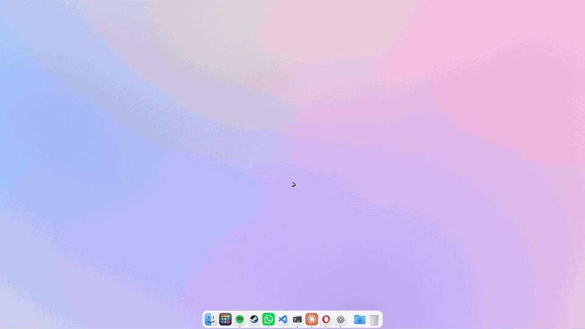

# OpenDock

[](https://github.com/leemadov/OpenDock/releases/latest)
[](https://github.com/leemadov/OpenDock/releases)
[](LICENSE)


A free, open-source macOS-style desktop for Windows 10/11, inspired by MyDockFinder. It's a single ~250 KB executable: no installer, no runtime to download and no SDK needed to build it.



### [⬇ Download OpenDock.exe](https://github.com/leemadov/OpenDock/releases/latest/download/OpenDock.exe)

Run it, and the dock and menu bar appear. Quit from the logo menu in the top-left corner. The exe isn't code-signed yet, so if Windows SmartScreen warns you, click **More info → Run anyway**.

## Why OpenDock?

- **Free and open source** (MIT). There's no paid version and nothing is locked.
- **Tiny and light.** A ~250 KB exe that uses almost no CPU when idle. The animation loop only runs while something is moving, and if it ever hangs, it restarts itself.
- **The whole macOS look, not just a dock:** a menu bar, Launchpad, Spotlight, Finder and Stacks.
- **Nothing to install.** It runs on the .NET Framework that ships with Windows, and building it only needs `build.bat`.
- **Hackable.** Plain C#, with one file per feature. See [How it's built](#how-its-built).

## Features

**Dock**
- Magnification that follows the cursor smoothly, with the dock widening around it
- Bouncing launch animation, running-app dots and hover name bubbles
- Drag icons to reorder them. Drag one off the dock to remove it (it disappears with a poof)
- Drop files onto an app to open them with it, onto the Trash to delete them, or onto empty space to pin them
- **Drag between windows**: hold anything you are dragging (files, text, links) over a running app's icon and its window comes to the front, so you can drop into it. This is macOS spring-loading, and it stands in for the Windows taskbar's drag-hover
- Open apps that aren't pinned show up automatically (Store apps included)
- Right-click an icon to see its open windows plus Keep in Dock, Show in Finder, Hide and Quit
- Downloads stack: a grid of your recent downloads with thumbnails
- Trash shows when it's empty or full and can be emptied from the dock
- **Live frosted glass**: whatever is behind the dock (your wallpaper, or a window you drag past it) shows through, lightly blurred. Space is reserved so maximized windows stop above the dock. OpenDock keeps itself out of screen capture so it can read what is behind it, and redraws only when that changes. One side effect: screenshots and screen recordings show what is behind the dock instead of the dock
- Auto-hide with a slide animation

**Menu bar**
- The bold name of the active app, plus File / Edit / View / Window / Help menus that send the matching shortcuts to that app
- Logo menu: About This PC, System Settings, Force Quit, Sleep, Restart, Shut Down, Lock Screen and Log Out
- Status icons for sound, battery, network, Spotlight and Control Center, plus the clock
- **Background Apps** (`^`): the apps that normally sit in the Windows system tray (Steam, WhatsApp, Discord and so on), with their tray icons. Clicking an app brings back its window: OpenDock first un-hides the app's hidden main window, then falls back to the app's Start-menu entry. Right-click an app to quit or force-quit it. **Windows Tray Icons…** opens the real Windows tray flyout, so you can use each app's own tray menu. Windows records every tray icon under `HKCU\Control Panel\NotifyIconSettings`, and OpenDock lists the ones whose process is running.
- Text switches between white and black based on how bright your wallpaper is

**Traffic lights on every app**: red/yellow/green dots cover each app's − □ × buttons and close, minimize or zoom the window. They turn gray when the window isn't active and show ×, − and + on hover. OpenDock asks each app where its buttons are (the same hit-test Windows uses for clicks, or UI Automation for apps like File Explorer), so it also works for apps that draw their own title bars. The dots are a small overlay that follows the window rather than a change inside the app, so they can trail a frame behind while you drag a window, and apps that don't report their buttons are left alone. You can turn this off in Settings.

**Launchpad**: every installed app (Win32 and Store) in pages. The desktop blurs and the icons zoom in when it opens. Swipe, scroll or use the arrow keys to change pages, and type to search. Start-menu clutter (web links, folder shortcuts, uninstallers, admin consoles, developer shells, WSL's Linux GUI apps) is filtered out. Right-click any app to choose **Hide from Launchpad**, and use **Show All** in Settings to bring hidden apps back. Spotlight still finds hidden apps.

**Spotlight** (`Alt+Space`): search apps, files (through the Windows Search index) and math (`12*7+3`), or fall back to a web search. `Ctrl+Enter` shows the selected result in Finder.

**Finder**: a file browser with traffic-light buttons, a sidebar (Applications, Desktop, Documents, Downloads, drives and so on), image and video thumbnails, back/forward, a filter box, drag and drop (including onto sidebar folders and Trash), copy/paste, Move to Trash, Get Info and New Folder.

**System Settings**: a macOS-style window with a sidebar and a real page for each category, so nothing sends you to the Windows Settings app. It covers Wi-Fi, Bluetooth, Network, Notifications, Sound, Displays, Wallpaper, Battery, Lock Screen, Privacy, Users, Keyboard, Mouse and Printers, plus OpenDock's own pages: Desktop & Dock (icon size, magnification, spacing between apps, auto-hide, animations, indicators), Appearance (Light, Dark or follow Windows) and Control Center (menu bar height). **Displays** also has **color profiles** (Standard, Vivid, OLED, Studio, Cinema, Night, Grayscale, or your own mix) that tint everything on screen while OpenDock runs. The **Wallpaper** page keeps a library: photos you add stay until you remove them. **About This PC** (logo menu) copies macOS's About This Mac.

## Build and run

```bat
build.bat
bin\OpenDock.exe
```

`build.bat` uses the C# compiler that ships with Windows (.NET Framework 4.8), so there's nothing to install. `build.bat check` runs the self-checks in `tests/`.

- Quit from the menu bar logo menu with **Quit OpenDock**, or run `OpenDock.exe --quit`.
- Settings live in `%APPDATA%\OpenDock\settings.txt` and errors are written to `error.log` in the same folder.

## The Windows taskbar

Explorer always creates the taskbar, so OpenDock keeps it out of sight instead. When **Hide the Windows taskbar** is on, OpenDock switches the taskbar to auto-hide and hides it completely. Auto-hide stays on after you quit, so together with **Open OpenDock at login** the taskbar never appears at sign-in. While OpenDock isn't running, you can still reach the taskbar at the bottom edge of the screen. Turning the setting off restores your original taskbar.

OpenDock reloads itself if it freezes. A watchdog thread pings the UI every 2 seconds, and if about 12 seconds pass with no answer it starts a fresh copy. It also restarts if the graphics driver resets (which can happen when a game starts), because WPF stops drawing when that happens.

## How it's built

Plain WPF written in code, one file per feature, in `src/`:

| File | What |
|---|---|
| `Dock.cs` | dock, drag ghost and poof, Downloads stack |
| `Preview.cs` | live window previews above a dock icon |
| `MenuBar.cs` | menu bar |
| `Launchpad.cs`, `Spotlight.cs` | full-screen app grid, search panel |
| `Finder.cs` | Finder window, the shared mac window chrome, the System Settings window |
| `Panes.cs`, `SystemInfo.cs` | the System Settings pages and About This PC; the Windows APIs behind them (audio, Wi-Fi, power, displays...) |
| `ColorProfiles.cs` | screen color profiles |
| `Glass.cs`, `Outside.cs` | frosted glass for windows and menus; closing menus when you click outside |
| `Shell.cs` | icons (via `IShellItemImageFactory`, or the 256px logo inside a Store app's package), installed apps, open windows, wallpaper |
| `App.cs` | startup, settings, taskbar hiding, reserved screen space, hotkey, window events |
| `Theme.cs`, `Art.cs` | light/dark palette and control templates, built-in vector icons |
| `Native.cs` | Win32 interop |

The blur doesn't use undocumented DWM APIs. The dock is excluded from screen capture (`SetWindowDisplayAffinity`), captures the strip behind itself at quarter size about 12 times a second and box-blurs it, only when the picture changed. On Windows older than 10 version 2004 it falls back to a blurred copy of the wallpaper. Launchpad, Spotlight and Stacks blur a snapshot of the screen taken as they open. The animation loop only runs while something is moving, so apart from the glass check the app does no work when idle.

## Not done yet

The genie minimize effect, window previews on hover, multiple monitors, a dock on the left or right edge, list view and rename in Finder, and per-app icon themes. Pull requests are welcome.

## License

MIT. OpenDock isn't affiliated with Apple or MyDockFinder, and all of its icons are original vector drawings.
